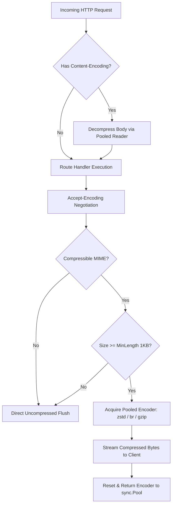

# Compression (`gokit/compression`)

`compression` provides high-performance, multi-codec HTTP middleware and streaming data compression for Go microservices. It features first-class support for **Zstandard (`zstd`)**, **Brotli (`br`)**, **Gzip (`gzip`)**, and **Deflate (`deflate`)** backed by zero-allocation `sync.Pool` buffer recycling, intelligent `Accept-Encoding` content negotiation with $q$-factor weighting, transparent request decompression, and threshold-based bypass.

---

## Why Modern Compression Matters

In distributed microservice architectures, payload transfer represents a major source of cloud egress bills, latency bottlenecks, and network serialization costs:
- **70–85% Egress Cost Reduction**: JSON and text payloads compress dramatically. A 100 KB JSON API payload compresses to ~15 KB with Brotli or Zstandard.
- **Zstandard vs Gzip**: Zstandard (`zstd`) delivers 3x–5x faster decompression speeds than Gzip while achieving superior compression ratios.
- **Brotli Web Compression**: Brotli (`br`) provides the highest static compression ratios for modern web browsers and mobile clients.
- **Memory Safety & Zero GC Overhead**: Direct per-request compressor allocations trigger severe GC pauses under high RPS. `gokit/compression` eliminates heap thrashing via specialized `sync.Pool` instances for all encoders, decoders, and buffers.

---

## Features

- **Multi-Algorithm Support**:
  - `EncodingZstandard` (`zstd`): Meta's modern codec; unmatched compression and decompression throughput.
  - `EncodingBrotli` (`br`): Google's high-density compression algorithm.
  - `EncodingGzip` (`gzip`): Universal RFC 1952 compression.
  - `EncodingDeflate` (`deflate`): Standard RFC 1951 raw deflate.
  - `EncodingIdentity` (`identity`): Uncompressed pass-through.
- **Intelligent HTTP Content Negotiation**:
  - Evaluates client `Accept-Encoding` quality weights ($q$-values, e.g. `br;q=1.0, gzip;q=0.8, *;q=0.1`).
  - Prioritizes server preferences: `zstd` > `br` > `gzip` > `deflate`.
  - Automatically manages `Vary: Accept-Encoding` headers to prevent CDN and reverse proxy cache poisoning.
- **Threshold-Based Buffering (`MinLength`)**:
  - Buffers payloads below `MinLength` (default 1024 bytes / 1 KB). Small responses avoid compression overhead where headers would inflate the payload size.
- **MIME-Type Whitelisting**:
  - Compresses text and structured formats (`application/json`, `text/html`, `image/svg+xml`, `application/wasm`, etc.).
  - Bypasses pre-compressed binary media (`image/jpeg`, `image/png`, `video/*`, `application/zip`).
- **Transparent Request Decompression**:
  - Automatically intercepts and decompresses incoming HTTP request bodies if `Content-Encoding` is present, making compression transparent to route handlers.
- **Direct Stream & Byte API**:
  - Stream wrappers: `NewWriter(codec, w)` and `NewReader(codec, r)`.
  - Byte helpers: `CompressBytes(codec, data)` and `DecompressBytes(codec, data)`.
  - Stream pipes: `Compress(codec, r, w)` and `Decompress(codec, r, w)`.

---

## Architecture & Lifecycle



---

## Quick Start

### 1. HTTP Server Middleware

Mount the compression middleware onto any Chi or `net/http` router:

```go
package main

import (
    "net/http"

    "github.com/dhawalhost/gokit/compression"
    "github.com/dhawalhost/gokit/router"
)

func main() {
    r := router.New()

    // Enable high-performance response compression & request decompression
    r.Use(compression.Middleware(
        compression.WithMinLength(1024), // Only compress payloads >= 1 KB
        compression.WithLevel(compression.LevelDefault),
    ))

    r.Get("/api/users", func(w http.ResponseWriter, r *http.Request) {
        w.Header().Set("Content-Type", "application/json")
        w.Write([]byte(`[{"id":"usr_1","name":"Alice","email":"alice@example.com"}]`))
    })

    http.ListenAndServe(":8080", r)
}
```

---

### 2. Direct Stream Compression & Decompression

Compress or decompress any `io.Reader` and `io.Writer`:

```go
package main

import (
    "bytes"
    "fmt"
    "os"

    "github.com/dhawalhost/gokit/compression"
)

func main() {
    // 1. Compress raw bytes with Zstandard
    raw := []byte("Large microservice domain payload to be stored in cache or object storage")
    compressed, err := compression.CompressBytes(compression.EncodingZstandard, raw)
    if err != nil {
        panic(err)
    }

    // 2. Decompress back to original
    decompressed, err := compression.DecompressBytes(compression.EncodingZstandard, compressed)
    if err != nil {
        panic(err)
    }

    fmt.Printf("Original: %d bytes, Compressed: %d bytes\n", len(raw), len(compressed))
    fmt.Printf("Restored: %s\n", string(decompressed))
}
```

---

### 3. File Streaming with Pooled Writers

Compress large file streams directly to disk or S3 without loading into RAM:

```go
outFile, err := os.Create("archive.tar.zst")
if err != nil {
    log.Fatal(err)
}
defer outFile.Close()

// Acquire pooled Zstd writer
zw, err := compression.NewWriter(compression.EncodingZstandard, outFile, compression.WithLevel(compression.LevelBestCompression))
if err != nil {
    log.Fatal(err)
}
defer zw.Close() // Flushes stream and returns encoder to sync.Pool!

io.Copy(zw, sourceFileReader)
```

---

## Configuration Reference

### `Options`

| Option | Default | Description |
|---|---|---|
| `WithLevel(Level)` | `LevelDefault` | Tradeoff between compression ratio and CPU usage (`LevelDefault`, `LevelBestSpeed`, `LevelBestCompression`) |
| `WithMinLength(int)` | `1024` (1 KB) | Minimum response size threshold required to trigger compression |
| `WithEncodings(...Encoding)` | `[zstd, br, gzip, deflate]` | Allowed compression algorithms in order of server preference |
| `WithMIMETypes(...string)` | Default MIME list | Whitelisted `Content-Type` prefixes to compress |
| `WithDecompression(bool)` | `true` | Automatically decompresses incoming request bodies if compressed |

---

## Codec Comparison Guide

| Algorithm | HTTP Token | Best Used For | Ratio | CPU Speed |
|---|---|---|---|---|
| **Zstandard** | `zstd` | High-throughput internal microservice RPCs, big datasets, cache payloads | Outstanding | Blazing (Decompression > 1 GB/s) |
| **Brotli** | `br` | Web frontend assets, modern mobile browsers (Chrome, Safari, Firefox) | Best | Moderate compression, fast decompression |
| **Gzip** | `gzip` | Universal fallback for legacy clients, API consumers | Good | Standard |
| **Deflate** | `deflate` | Raw deflate streams, legacy embedded clients | Moderate | Standard |
