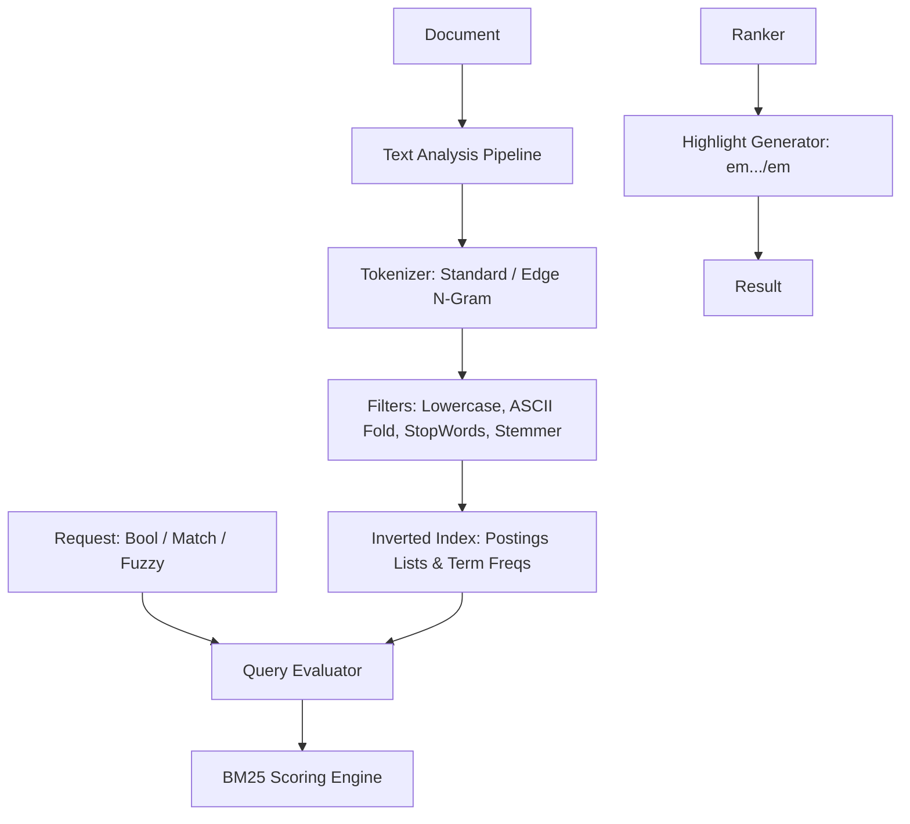

# Search (`gokit/search`)

`search` provides an embedded, thread-safe, high-performance in-memory full-text search engine for Go microservices. It features inverted index postings, state-of-the-art **Okapi BM25** relevance scoring, configurable text analysis pipelines (tokenization, ASCII folding, stop-word removal, and stemming), rich query clauses (Boolean, Fuzzy typo tolerance, Phrase slop, Prefix, and Numeric Range), and snapshot persistence.

---

## Why an Embedded Search Engine?

Modern microservices often need fast, ranked search capabilities for catalogs, users, audit logs, or configuration items. Spinning up and maintaining an external Elasticsearch or OpenSearch cluster introduces heavy operational overhead, JVM memory bloat, network latency, and infrastructure costs.

`gokit/search` solves this by delivering an embedded, pure-Go search engine that runs in-process with sub-millisecond query evaluation, zero external dependencies, and atomic persistence.

---

## Features

- **Okapi BM25 Relevance Scoring**: Industry-standard ranking with configurable term frequency saturation ($k_1$) and document length normalization ($b$).
- **Pluggable Text Analysis**:
  - `StandardTokenizer`: Unicode punctuation and whitespace boundary segmentation.
  - `WhitespaceTokenizer`: Whitespace-only splitting.
  - `EdgeNGramTokenizer`: Prefix character n-grams designed for instant autocomplete and typeahead search.
  - Composable filter pipeline: `LowercaseFilter`, `ASCIIFoldFilter` (accents/diacritics), `StopWordsFilter` (built-in English dictionary), `MinLengthFilter`, and suffix `StemmerFilter`.
- **Expressive Query API**:
  - `MatchQuery`: Analyzes input text and scores matching terms with `AND` or `OR` coordination.
  - `MultiMatchQuery`: Queries across multiple fields with field-level relevance boosting (e.g., `title^3.0`, `content^1.0`).
  - `BoolQuery`: Boolean compound queries with `Must` (AND), `Should` (OR with `MinimumShouldMatch`), `MustNot` (NOT exclusion), and `Filter` (unscored binary filters).
  - `FuzzyQuery`: Levenshtein edit-distance matching ($d \le 2$) for typo tolerance and prefix locking.
  - `PhraseQuery`: Positional matching ensuring words appear in exact consecutive order with configurable positional displacement (`Slop`).
  - `PrefixQuery`: Fast prefix matching against indexed terms.
  - `RangeQuery`: Filter documents by numeric boundaries (`GTE`, `GT`, `LTE`, `LT`).
  - `TagQuery`: Constant-time exact match against categorical document tags.
- **Result Highlighting**: Automatically generates contextual snippets wrapping matched terms in `<em>...</em>` tags.
- **Thread-Safe & Concurrent**: Protected by fine-grained `sync.RWMutex` supporting hundreds of concurrent readers and writers without data races.
- **Persistence & Snapshots**: Stream index state directly to and from `io.Reader` and `io.Writer` (e.g., local disk, AWS S3, or GCS via `gokit/storage`).

---

## Architecture & Query Lifecycle



---

## Quick Start

### 1. Basic Indexing & Full-Text Search

```go
package main

import (
    "context"
    "fmt"
    "log"

    "github.com/dhawalhost/gokit/search"
)

func main() {
    ctx := context.Background()
    idx := search.NewMemoryIndex()
    defer idx.Close()

    // 1. Index documents
    docs := []*search.Document{
        search.NewDocument("article_1").
            SetField("title", "Go Concurrency Patterns").
            SetField("content", "Pipelines, worker pools, and channels in Go microservices.").
            SetNumeric("views", 14200).
            AddTag("golang", "concurrency"),

        search.NewDocument("article_2").
            SetField("title", "Distributed Caching with Redis").
            SetField("content", "Building high-performance two-tier L1/L2 caches.").
            SetNumeric("views", 8900).
            AddTag("redis", "cache"),
    }

    if err := idx.IndexBatch(ctx, docs); err != nil {
        log.Fatal(err)
    }

    // 2. Search with BM25 ranking and highlighting
    res, err := idx.Search(ctx, search.Request{
        Query:           search.NewMatchQuery("content", "worker pools"),
        Limit:           10,
        HighlightFields: []string{"content"},
    })
    if err != nil {
        log.Fatal(err)
    }

    fmt.Printf("Total hits: %d (Took: %v)\n", res.TotalHits, res.Took)
    for _, hit := range res.Hits {
        fmt.Printf("- [%.2f] %s: %s\n", hit.Score, hit.DocID, hit.Highlights["content"][0])
    }
}
```

---

### 2. Multi-Field Search with Boosting

Search across `title` (boosted by 3.0x) and `content` (1.0x):

```go
q := search.NewMultiMatchQuery("Redis caching", "title", "content").
    SetFieldBoost("title", 3.0).
    SetFieldBoost("content", 1.0).
    WithOperator("OR")

res, err := idx.Search(ctx, search.Request{Query: q})
```

---

### 3. Autocomplete & Typeahead Search

Use `NewAutocompleteAnalyzer` to generate edge n-grams for instant typeahead search:

```go
// Configure index with autocomplete analyzer for the 'suggest' field
cfg := search.IndexConfig{
    DefaultAnalyzer: search.NewStandardAnalyzer(),
    FieldAnalyzers: map[string]*search.Analyzer{
        "suggest": search.NewAutocompleteAnalyzer(2, 6),
    },
}
idx := search.NewMemoryIndex(cfg)

// Index term: 'microservice' generates: 'mi', 'mic', 'micr', 'micro', 'micros'
doc := search.NewDocument("svc_1").SetField("suggest", "microservices")
idx.Index(ctx, doc)

// Search with prefix query as user types
res, err := idx.Search(ctx, search.Request{
    Query: search.NewTermQuery("suggest", "micr"),
})
```

---

### 4. Typo-Tolerant Fuzzy Search

Match terms with minor spelling errors using Levenshtein edit distance:

```go
// User typed "concurrensy" (typo with distance 1)
fuzzyQuery := search.NewFuzzyQuery("title", "concurrensy").
    WithMaxEdits(1).
    WithPrefixLength(3)

res, err := idx.Search(ctx, search.Request{Query: fuzzyQuery})
```

---

### 5. Snapshot & Restore to Storage

Backup and restore the search index to disk or object storage:

```go
// 1. Export snapshot to buffer or file
var buf bytes.Buffer
if err := search.Snapshot(ctx, idx, &buf); err != nil {
    log.Fatal(err)
}

// 2. Restore into a fresh index
freshIdx := search.NewMemoryIndex()
if err := search.Restore(ctx, freshIdx, &buf); err != nil {
    log.Fatal(err)
}
```

---

## Configuration Reference

### `IndexConfig`

| Field | Type | Default | Description |
|---|---|---|---|
| `DefaultAnalyzer` | `*Analyzer` | `NewStandardAnalyzer()` | Analyzer applied to unconfigured text fields |
| `FieldAnalyzers` | `map[string]*Analyzer` | `nil` | Per-field custom analyzer overrides |
| `K1` | `float64` | `1.2` | BM25 term frequency saturation parameter |
| `B` | `float64` | `0.75` | BM25 document length normalization parameter |

---

## Query Types Summary

| Query | Constructor | Purpose |
|---|---|---|
| `TermQuery` | `NewTermQuery(field, term)` | Exact term lookup |
| `MatchQuery` | `NewMatchQuery(field, text)` | Analyzed text query with BM25 scoring |
| `MultiMatchQuery` | `NewMultiMatchQuery(text, fields...)` | Multi-field search with field weights |
| `BoolQuery` | `NewBoolQuery()` | Boolean coordination (`Must`, `Should`, `MustNot`, `Filter`) |
| `FuzzyQuery` | `NewFuzzyQuery(field, term)` | Typo-tolerant edit distance matching |
| `PhraseQuery` | `NewPhraseQuery(field, terms...)` | Positional phrase match with slop |
| `PrefixQuery` | `NewPrefixQuery(field, prefix)` | Term prefix scanning |
| `RangeQuery` | `NewRangeQuery(field)` | Numeric range filtering (`GTE`, `GT`, `LTE`, `LT`) |
| `TagQuery` | `NewTagQuery(tag)` | Exact categorical tag match |
